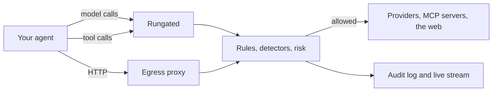

<div class="rg-hero" markdown>

<span class="rg-eyebrow">Open source &middot; Apache 2.0</span>

# Every agent action, <span class="rg-grad">checked before it runs</span>

<p class="rg-lede">Rungated sits between your AI agent and everything it touches. Model calls, tool calls and outbound requests are checked against the agent's rulebook, scored for risk, and then allowed, redacted, held for a person, blocked or contained.</p>

<div class="rg-actions" markdown>
[Quickstart](quickstart.md){ .md-button .md-button--primary }
[How it works](concepts.md){ .md-button }
</div>

<div class="rg-terminal" markdown>
<div class="rg-terminal__bar"><span></span><span></span><span></span></div>

```bash
curl -fsSL https://github.com/amareshhebbar/rungated/releases/latest/download/install.sh | sh
rungated serve --dev
open http://localhost:8080
```

</div>

</div>

## Start here

<div class="grid cards" markdown>

*   :material-lightning-bolt:{ .lg } **Quickstart**

    Run the gateway and see your first decision in five minutes.

    [:material-arrow-right: Open](quickstart.md)

*   :material-power-plug:{ .lg } **Connect your agent**

    Change one base URL. Route MCP servers and outbound HTTP.

    [:material-arrow-right: Open](connect/llm_proxy.md)

*   :material-chip:{ .lg } **Models**

    Free embedders forever, stronger models free to try.

    [:material-arrow-right: Open](models/overview.md)

*   :material-layers-triple:{ .lg } **Free and Enterprise**

    What is open source and what Enterprise adds.

    [:material-arrow-right: Open](editions.md)

</div>

## What it handles

| Problem | What Rungated does |
| --- | --- |
| A web page or document tells the agent to ignore its instructions | Scans everything the model reads and quarantines hidden instructions |
| The agent calls a tool it should not | Checks every tool call against the agent's rulebook before it runs |
| Secrets or customer data leave through the model or the network | Redacts values before the provider sees them and scans outbound requests |
| A risky action needs a person | Holds it and waits for approval in the Console |
| An agent is compromised | Contains it: revokes its tokens and refuses further actions |
| Nobody can say what an agent did | Hash chained audit log, live stream and incident timelines |

## How it fits



## What it is not

Rungated enforces the rules you declare and detects known attack patterns. It does not stop prompt injection in general, and it cannot protect an agent that skips it. Read [Limits](security/limits.md) before you rely on it.
